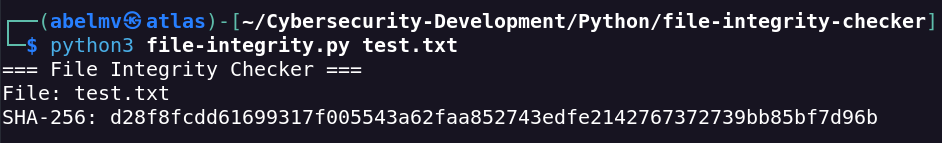
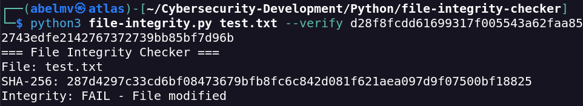
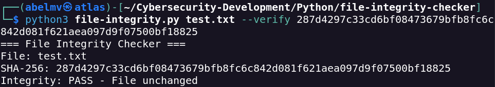
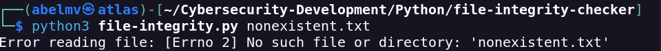

# File Integrity Checker

## Overview

**Status:** Completed — v1.0  
**Language:** Python 3  
**Tested environment:** Kali Linux, Python 3.14.8  
**Dependencies:** Python standard library only (`argparse`, `hashlib`, `pathlib`)

File Integrity Checker is a Python command-line tool that calculates the SHA-256 digest of a file and optionally compares it with a supplied reference hash. It provides a straightforward way to practise file integrity verification and cryptographic hashing.

The tool performs an **on-demand comparison**. It does not continuously monitor files or determine whether their contents are safe.

## Objectives

- Calculate a SHA-256 digest for a selected file.
- Compare the calculated digest against an expected reference value.
- Detect discrepancies between file contents and a trusted reference hash.
- Handle file access errors without displaying an unhandled traceback.
- Practise Python command-line programming and file handling.

## Requirements

- Python **3.11 or later**, for `hashlib.file_digest()`.
- Read permission for the selected file.

No third-party Python packages are required.

## Usage

Run the script from its directory, or provide its path explicitly.

### Calculate a SHA-256 hash

```bash
python3 file-integrity.py test.txt
```

Example output (abbreviated):

```text
=== File Integrity Checker ===
File: test.txt
SHA-256: <64-character hexadecimal digest>
```

### Verify a file against a reference hash

```bash
python3 file-integrity.py test.txt --verify EXPECTED_SHA256
```

Replace `EXPECTED_SHA256` with a known, trusted SHA-256 digest. The script prints the calculated digest and one of these messages:

```text
Integrity: PASS - File unchanged
```

or

```text
Integrity: FAIL - File modified
```

The reported `PASS`/`FAIL` is relative to the reference hash supplied by the user. A mismatch could result from a changed file **or** an incorrect reference hash.

### Command-line help

```bash
python3 file-integrity.py --help
```

### Exit behaviour

| Condition | Behaviour |
| --- | --- |
| Hash calculation without `--verify` | Prints SHA-256 and exits successfully if readable |
| Reference hash matches | Prints `PASS` and exits with status `0` |
| Reference hash differs | Prints `FAIL` and exits with status `1` |
| File cannot be opened or read | Prints an error and exits with status `1` |

The current version does not validate that the `--verify` argument is a 64-character hexadecimal SHA-256 digest before comparison.

## Implementation

| Python component | Purpose |
| --- | --- |
| `argparse` | Reads the file path and optional `--verify` argument |
| `pathlib.Path` | Opens the selected file in binary mode |
| `hashlib.file_digest(file, "sha256")` | Calculates a SHA-256 digest from the file contents |
| `try` / `except OSError` | Handles file access and read errors |

The file is read in binary mode (`rb`) so the hash is calculated from its bytes, not from a decoded text representation.

**Source code:** [`file-integrity.py`](file-integrity.py)

## Validation and Evidence

Four tests were documented during development in the Kali Linux environment.

### E01 — SHA-256 Hash Generation

The tool generated a SHA-256 digest for the local test file `test.txt`.



### E02 — File Modification Detection

After the test file's contents changed, comparison against the earlier reference hash produced a mismatch. The tool reported `Integrity: FAIL - File modified`.



### E03 — File Integrity Verification

Comparing the current file against its matching reference hash produced `Integrity: PASS - File unchanged`.



### E04 — Invalid File Handling

Attempting to hash a non-existent file (`nonexistent.txt`) produced a controlled file-reading error.



### Results Summary

| Test | Observed result |
| --- | --- |
| SHA-256 calculation | Digest generated |
| Comparison with previous digest after content change | `FAIL` as expected |
| Comparison with matching digest | `PASS` as expected |
| Non-existent file | Error handled |

These screenshots record the tested cases; they are not a substitute for comprehensive automated tests.

## Security Considerations and Limitations

- The reference hash must come from a **trusted source**. Comparing against an untrusted digest does not establish authenticity.
- A matching SHA-256 digest supports a content-integrity check; it does **not** prove that a file is benign or malware-free.
- A failed comparison proves only that the calculated and supplied values differ; it does not establish the cause.
- The tool checks one file at a time and does not provide continuous file integrity monitoring.
- The script does not validate the format of the supplied reference hash.
- It does not create a trusted baseline, signed manifest or audit log.

## Lessons Learned

This project provided practical experience with cryptographic hash functions, file access, CLI argument parsing, exception handling and interpreting integrity-check results. These concepts are relevant to digital forensics, incident response and defensive security workflows.

## Future Improvements

- Validate reference SHA-256 hash format.
- Verify multiple files using a trusted manifest.
- Export integrity-check results to a structured report.
- Add automated tests for successful and failed comparisons.
- Explore periodic monitoring as a separate, future capability.

## References

- [Python hashlib documentation](https://docs.python.org/3/library/hashlib.html)
- [Python argparse documentation](https://docs.python.org/3/library/argparse.html)
- [Python pathlib documentation](https://docs.python.org/3/library/pathlib.html)

---

*Part of the [Security Scripts & Automation](../../README.md) repository.*
