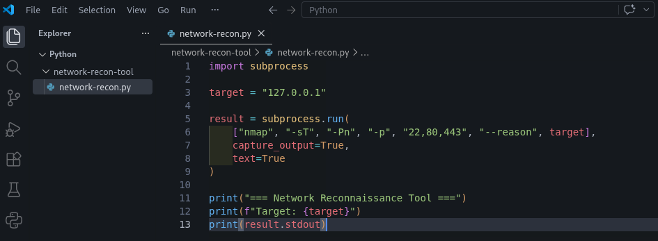
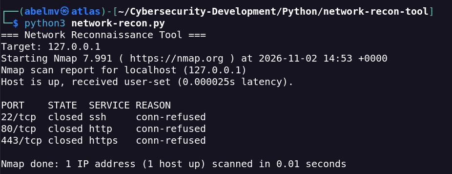
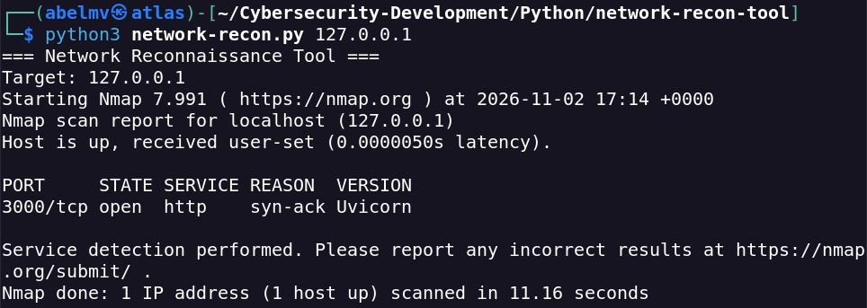
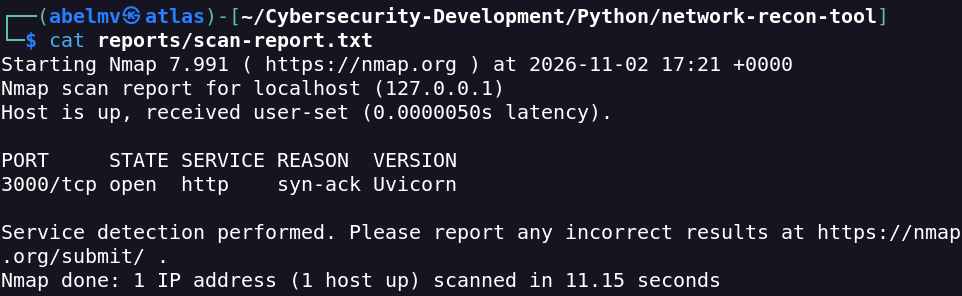

# Nmap Reconnaissance Tool

**Version:** 1.0  
**Language:** Python 3  
**Test environment:** Kali Linux, Nmap 7.99.1  
**Status:** Completed — locally tested

## Overview

A Python command-line tool that automates basic IPv4 network reconnaissance by invoking Nmap. It accepts a target address and a list of TCP ports, displays scan output in the terminal and optionally saves the results as a text report.

The tool wraps Nmap; it does not implement its own port scanner or vulnerability assessment engine.

## Features

- Validates an IPv4 target using Python's `ipaddress` module.
- Accepts comma-separated TCP ports (`1`–`65535`); defaults to `22,80,443`.
- Runs Nmap with TCP Connect scanning (`-sT`), service/version detection (`-sV`), no host discovery (`-Pn`) and reason reporting (`--reason`).
- Displays Nmap's standard output in the terminal.
- Optionally saves a TXT report in `reports/` without overwriting an existing file.
- Handles invalid arguments, a missing Nmap executable, non-zero Nmap exit status and scan timeouts.

## Requirements

- Python 3 (standard library only; no third-party Python packages)
- Nmap available in `PATH`
- Permission to scan the chosen target

On Kali Linux, install Nmap if necessary:

```bash
sudo apt update
sudo apt install nmap
```

## Usage

Run commands from this tool's directory:

**Scan the default TCP ports (22, 80 and 443):**

```bash
python3 network-recon.py 127.0.0.1
```

**Select a port:**

```bash
python3 network-recon.py 127.0.0.1 -p 3000
```

**Select multiple ports:**

```bash
python3 network-recon.py 127.0.0.1 -p 22,80,443
```

**Save a text report:**

```bash
python3 network-recon.py 127.0.0.1 -p 3000 -o scan-report.txt
```

Reports are saved to the local `reports/` directory. This directory is excluded from version control by the repository's `.gitignore`. If a report already exists, the script refuses to overwrite it.

**Display help:**

```bash
python3 network-recon.py --help
```

## Implementation

| Python component | Purpose |
|---|---|
| `argparse` | Parse the target, port list and optional output filename |
| `ipaddress` | Validate IPv4 address syntax |
| `subprocess` | Execute Nmap and capture standard output and errors |
| `pathlib` | Create the report directory and construct the output path |

The Nmap command generated by the script follows this pattern:

```bash
nmap -sT -sV -Pn -p 3000 --reason 127.0.0.1
```

A 60-second timeout is applied to each Nmap process. The output filename is restricted to a basename, although the script currently checks that restriction **after** completing the scan.

## Evidence and Observed Results

These screenshots document the development and local verification of the tool. E01 and E02 include earlier development-stage runs and should not be interpreted as separate executions of the final v1.0 code.

### E01 — Python and Nmap Integration

Initial integration of Nmap execution from Python using `subprocess`.



### E02 — Localhost Scan

An early scan of TCP ports 22, 80 and 443 on `127.0.0.1`, reported as closed in the recorded test.



### E03 — Service Version Detection

A scan of TCP port 3000 on localhost reported an open HTTP service identified as Uvicorn in the recorded environment.



### E04 — TXT Report Generation

The script saved Nmap output to a report file through its `-o` option.



### Recorded Validation

| Check | Recorded result |
|---|---|
| IPv4 validation | Passed |
| Port validation | Passed |
| TCP scanning | Passed |
| Service/version detection | Passed |
| TXT report generation | Passed |
| Report overwrite protection | Passed |
| Missing Nmap executable handling | Passed |

These results come from the original lab record; they are not a substitute for an automated test suite.

## Security Considerations and Limitations

- **Authorisation:** Use only on systems you own or are explicitly permitted to assess. IPv4 syntax validation does not verify authorisation.
- **Scan scope:** The tool performs TCP Connect scans on specified IPv4 ports; it does not perform UDP scanning, IPv6 scanning, or comprehensive vulnerability assessment.
- **Service identification:** Detected versions are informational and do not prove that a vulnerability exists.
- **Reports:** Scan results can reveal infrastructure details. Keep private reports out of the public repository.
- **Input handling:** The script passes arguments to `subprocess.run()` as a list, without `shell=True`.
- **Known limitation:** The output filename is validated after the scan rather than before it. Improving this and adding automated tests are future work.

## Future Improvements

- Validate the report filename before running Nmap.
- Add IPv6 and TCP port-range support.
- Add machine-readable JSON and HTML report options.
- Compare scan results over time.
- Add automated tests and refactor into reusable functions.

## References

- [Nmap Reference Guide](https://nmap.org/book/man.html)
- [Python argparse](https://docs.python.org/3/library/argparse.html)
- [Python subprocess](https://docs.python.org/3/library/subprocess.html)
- [Python ipaddress](https://docs.python.org/3/library/ipaddress.html)
